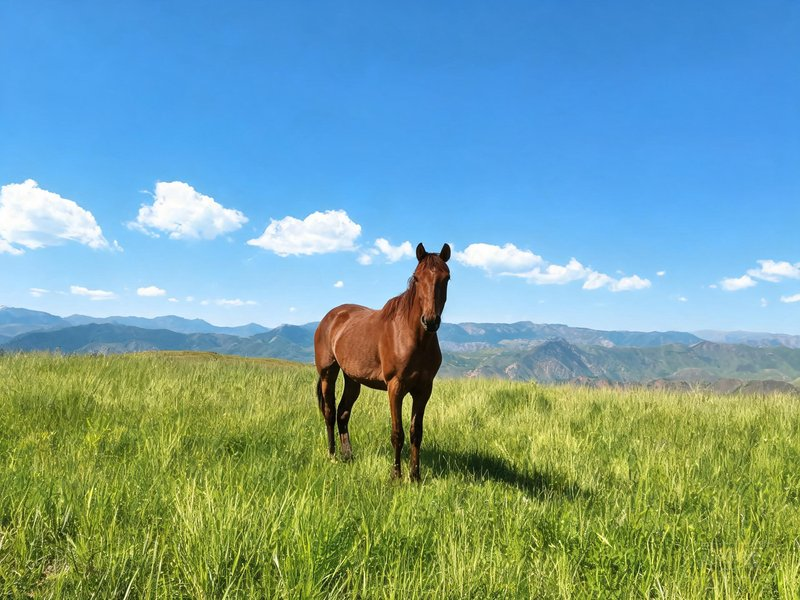
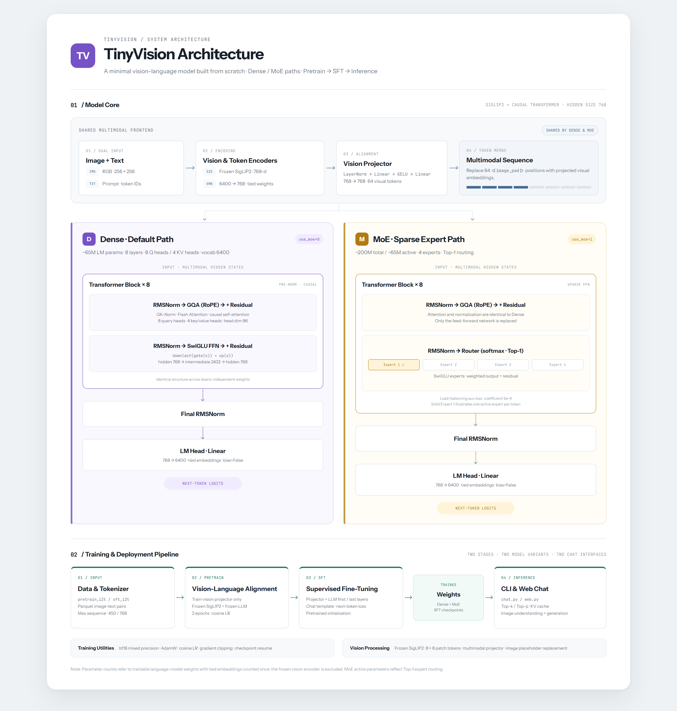
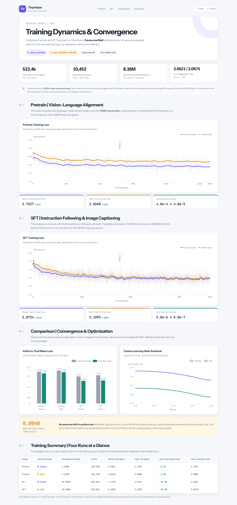

# TinyVision

[English](README.md) | [简体中文](README.zh-CN.md)

A minimal vision-language model (VLM) with a hand-written model architecture, covering the complete **data → pretraining → fine-tuning → conversion → deployment** pipeline for learning and reproduction.

- **Vision encoder**: SigLIP 2 (`siglip2-base-p32-256-ve`, 32×32 patches, 256×256 input), frozen throughout training and inference, producing 64 visual tokens
- **Language model**: A Llama-style architecture written in pure PyTorch (RMSNorm / RoPE / GQA / SwiGLU), initialized from flcmind SFT weights by default, with optional fully random initialization
- **Two LM variants**: Dense (65.09M) and MoE (199.60M, 4 experts with Top-1 routing, 65.12M activated parameters per token)
- **Tokenizer**: A custom tokenizer with a 6,400-token vocabulary and visual special tokens such as `<|image_pad|>`
- **Projector**: An MLP with LayerNorm → Linear → GELU → Linear, mapping visual features into the language model space

| Resource | Link |
|---|---|
| Model weights | [FLCgeigeigei/tinyvision-vlm](https://huggingface.co/FLCgeigeigei/tinyvision-vlm) (`dense/` and `moe/`) |
| Training data | [FLCgeigeigei/tinyvision-vlm-data](https://huggingface.co/datasets/FLCgeigeigei/tinyvision-vlm-data) |

## Contents

- [Model Outputs](#model-outputs)
- [Model Architecture](#model-architecture)
- [Installation](#installation)
- [Download Weights and Data](#download-weights-and-data)
- [Quick Start](#quick-start)
- [Training](#training)
- [Model Conversion and Deployment](#model-conversion-and-deployment)
- [Dataset](#dataset)
- [Project Structure](#project-structure)
- [Known Limitations](#known-limitations)

## Model Outputs

Dense and MoE responses for the same set of images. These examples show raw model behavior. Sampling is non-deterministic, so responses may vary with checkpoints, prompts, and decoding parameters. Objects and attributes in the responses may be described incorrectly.

| Input | Dense | MoE |
|---|---|---|
|  | 这张图片展示了一艘帆船在海上航行，船体是白色的。 | 这张图片展示了一艘帆船在水面上，看起来是在晴朗的蓝天下。船只主要是白色的，带有白色的帆，表明它是白色的。 |
|  | 这张图片展示了一匹马站在一片开阔的草地上，背景是晴朗的蓝天。 | 这张图片展示了一匹棕色的马，站在一片广阔的草地上，背景是晴朗的蓝天。这匹马有着浓密的胡须，头部略微向前倾斜，眼睛朝向画面右侧。 |
|  | 这张图片展示了一幅宁静的风景，在晴朗的蓝天下，一座山峰被积雪覆盖，暗示着寒冷的季节。 | 这张图片展示了一幅宁静的山脉景观，天空湛蓝，暗示着一个宁静的场景。前景是一片宁静的湖泊，湖面上倒映着天空的蓝色。 |
|  | 这张图片展示了一只鸟停在一根长长的叶子上，背景是郁郁葱葱的绿色植被。 | 这张图片展示了一只鸟停在一根细长的茎上，背景是郁郁葱葱的绿色。这只鸟主要是蓝色的，带有白色的鳞片，头部和腹部有白色的鳞片。 |

## Model Architecture



SigLIP 2 encodes each image into 64 patch tokens. An MLP projector (LayerNorm → Linear → GELU → Linear) maps these tokens to the language model dimension. The projected features replace the `<|image_pad|>` placeholders in the text before being fed into the decoder-only language model.

The vision encoder (SigLIP 2 base, 32×32 patches, 256×256 input) remains frozen and outputs 64 tokens with 768 dimensions each. The projector maps these 64 visual tokens into the language model's 768-dimensional space. The language model uses a hand-written architecture and is initialized from the flcmind SFT base by default. Set `--from_weight none` to use fully random initialization without loading existing LLM weights.

### Parameter Comparison

| | Dense | MoE |
|---|---|---|
| Parameters (language model only) | 65.09M | 199.60M (65.12M activated) |
| FFN | SwiGLU | 4 experts with Top-1 routing and a load-balancing auxiliary loss |
| `hidden_size` / layers | 768 / 8 | 768 / 8 |
| Attention | GQA (8 query heads / 4 KV heads, `head_dim=96`) | GQA (8 query heads / 4 KV heads, `head_dim=96`) |
| Normalization | RMSNorm (`eps=1e-6`) | RMSNorm (`eps=1e-6`) |
| Positional encoding | RoPE (`theta=1e6`, optional YaRN) | RoPE (`theta=1e6`, optional YaRN) |
| Vocabulary | 6,400 | 6,400 |
| Image tokens | 64 (256×256 input, 32×32 patches) | 64 (256×256 input, 32×32 patches) |
| Inference precision | Direct bf16 support | MoE FFN internally uses fp32; fall back to fp32 if needed |

See the [training report](figures/tinyvision-training-report.png) for training curves and convergence comparisons.

## Installation

Python 3.9+ and PyTorch 2.0+ are required. A CUDA build of PyTorch is recommended for training, while inference also supports CPU. See the [official PyTorch installation page](https://pytorch.org/get-started/locally/) for the appropriate CUDA installation command.

```bash
# Run from the project root
pip install -e .
pip install -U huggingface_hub  # Provides the hf command used below

# Optional: Gradio web UI / SwanLab training logs
pip install -e ".[web,log]"
```

See [pyproject.toml](pyproject.toml) for the remaining dependencies.

## Download Weights and Data

Model weights and training data are not included in `assets/` because of their size. Complete the first two steps for inference. The LLM base weights and training data are only needed for training.

### 1. Language Model Weights (Required for Inference)

```bash
hf download FLCgeigeigei/tinyvision-vlm --local-dir tinyvision-vlm
```

The downloaded `tinyvision-vlm/dense/` and `tinyvision-vlm/moe/` directories contain Transformers-format models that can be used directly for command-line inference.

### 2. Vision Encoder (Required for Training and Inference)

The language model weights do **not** include the SigLIP 2 vision encoder (approximately 180 MB). Copy the encoder downloaded in the previous step to the default directory:

```bash
mkdir -p assets/vision_encoder
cp -r tinyvision-vlm/vision_encoder/siglip2-base-p32-256-ve assets/vision_encoder/
```

Alternatively, download it directly from the variant repository to the default directory (its `model.safetensors` is identical to the copy above):

```bash
hf download jingyaogong/siglip2-base-p32-256-ve --local-dir assets/vision_encoder/siglip2-base-p32-256-ve
```

Use `--vision_model` to specify another path in the web UI, or set the `TINYVISION_VISION_MODEL` environment variable in other scenarios.

### 3. Pretrained LLM Base (Required for Training)

By default, the language model is initialized from [FLCgeigeigei/flcmind](https://huggingface.co/FLCgeigeigei/flcmind) SFT weights rather than random parameters. Download the Dense and MoE base weights into `assets/pretrained/`:

```bash
hf download FLCgeigeigei/flcmind --include "*.pth" --local-dir flcmind_hf

mkdir -p assets/pretrained
cp flcmind_hf/full_sft_768.pth     assets/pretrained/
cp flcmind_hf/moe_sft_768_moe.pth  assets/pretrained/
```

`resolve_weight_path()` searches `assets/pretrained/` using the naming pattern `{prefix}_{hidden_size}[_moe].pth`. The prefixes must therefore match: `full_sft` → `full_sft_768.pth` (Dense), and `moe_sft` → `moe_sft_768_moe.pth` (MoE). To train without existing LLM weights, explicitly pass `--from_weight none`.

### 4. Training Data (Required for Training)

The training entry point reads a single parquet file by default. The following commands download all shards for both configurations and export them to the default paths:

```bash
mkdir -p assets/data

python -c "from datasets import load_dataset; load_dataset('FLCgeigeigei/tinyvision-vlm-data', 'pretrain_i2t', split='train').to_parquet('assets/data/pretrain_i2t.parquet')"
python -c "from datasets import load_dataset; load_dataset('FLCgeigeigei/tinyvision-vlm-data', 'sft_i2t', split='train').to_parquet('assets/data/sft_i2t.parquet')"
```

This process retains both the Hugging Face cache and the exported parquet files, so reserve sufficient disk space. You can also use `--data_path` to specify another single parquet file.

## Quick Start

### 1. Command-Line Image Question Answering

After completing the first two steps in “Download Weights and Data,” load the downloaded Transformers models directly:

```bash
# Dense
tinyvision-chat --load_from tinyvision-vlm/dense

# MoE
tinyvision-chat --load_from tinyvision-vlm/moe
```

By default, the program iterates over every image in `assets/demo_images/` and describes them one by one. To load your own native `.pth` weights, use the default `--load_from model`:

```bash
# Dense native pth
tinyvision-chat

# MoE native pth
tinyvision-chat --use_moe 1
```

Native weights are searched in `assets/pretrained/` and `assets/outputs/*/final/` (`resolve_weight_path` order: explicit `--save_dir` → `pretrained/` → `outputs/{weight}/final/`). This lookup does not apply to Transformers directories specified with `--load_from`.

| Argument | Description | Default |
|---|---|---|
| `--use_moe` | Whether native pth weights use the MoE architecture; Transformers models read this from config | 0 |
| `--load_from` | Model source: `model` for native pth, otherwise a Transformers-format path | `model` |
| `--save_dir` | Weight directory | Auto-detect |
| `--weight` | Weight filename prefix | `sft_vlm` |
| `--image_dir` | Test image directory | `assets/demo_images` |
| `--max_new_tokens` | Maximum generation length | 512 |
| `--temperature` / `--top_p` | Sampling temperature / nucleus threshold | 0.7 / 0.85 |
| `--device` | Runtime device | `cuda` when available, otherwise `cpu` |
| `--show_speed` | Print decode speed (tokens/s) | 1 |

### 2. Web UI

```bash
tinyvision-web
```

The web UI scans Transformers-format models in `assets/outputs/transformers/`; conversion must be run first. Open the Gradio address in a browser to upload images and chat interactively. The model dropdown can switch between multiple converted models.

### 3. Load from Hugging Face

```python
from transformers import AutoModelForCausalLM, AutoTokenizer

model = AutoModelForCausalLM.from_pretrained(
    "FLCgeigeigei/tinyvision-vlm", subfolder="dense", trust_remote_code=True, dtype="bfloat16"
)
tokenizer = AutoTokenizer.from_pretrained("FLCgeigeigei/tinyvision-vlm", subfolder="dense")

# The LLM weights do not include the vision encoder; attach it separately
model.vision_encoder, model.processor = model.get_vision_model(
    "tinyvision-vlm/vision_encoder/siglip2-base-p32-256-ve"
)
```

Notes:
- `trust_remote_code=True` is required. The custom architecture is loaded from `vlm.py` through `auto_map`.
- Each image corresponds to **64 `<|image_pad|>` tokens**, matching the number of patches produced by SigLIP 2 for 256×256 inputs.
- The LLM weights do **not** include the vision encoder (`model.safetensors` only contains the language model and projector), so it must be attached separately.
- `dense` supports `bfloat16` directly. The MoE FFN in `moe` internally upcasts to fp32; if NaNs still occur, fall back to `dtype="float32"`.
- The model includes `chat_template.jinja`. Use `tokenizer.apply_chat_template(messages, tokenize=False, add_generation_prompt=True)` to construct inputs.
- See the [Hugging Face model card](https://huggingface.co/FLCgeigeigei/tinyvision-vlm) for a complete example.

## Training

Both stages share the same entry point and are selected with `--stage`.

Explicitly specifying `--from_weight` is recommended to avoid mixing up Dense and MoE initialization weights:

```bash
# Dense: 1. Image-text pretraining; freeze the LLM and vision encoder, training only the projector
tinyvision-train --stage pretrain --from_weight full_sft

# Dense: 2. Supervised fine-tuning; continue from pretraining and unfreeze the first and last LLM layers
tinyvision-train --stage sft

# MoE: 1. Image-text pretraining
tinyvision-train --stage pretrain --use_moe 1 --from_weight moe_sft

# MoE: 2. Supervised fine-tuning
tinyvision-train --stage sft --use_moe 1
```

The default data paths are `assets/data/pretrain_i2t.parquet` and `assets/data/sft_i2t.parquet`. `--data_path` currently reads a single parquet file; when using dataset shards, first export and merge them with the commands in “Download Weights and Data.” Outputs are saved to `assets/outputs/{model_name}/final/` (`.pth`, without vision encoder weights), and checkpoints are saved to `assets/outputs/{model_name}/checkpoints/`.

The Dense two-stage workflow used by the commands above is:

```text
[Dense LLM base]
assets/pretrained/full_sft_768.pth
        │
        │ Pretrain: train only the projector
        ▼
[Pretraining output]
assets/outputs/pretrain_vlm/final/pretrain_vlm_768.pth
        │
        │ SFT: unfreeze the first and last LLM layers
        ▼
[SFT output]
assets/outputs/sft_vlm/final/sft_vlm_768.pth
```

In short: **pretraining starts from the flcmind LLM base** (only the projector is trained), then **SFT continues from the pretraining output** (the first and last layers are unfrozen). `--from_weight` can be changed to another prefix or `none` for fully random initialization.

The table below lists the original CLI defaults. Note that pretraining defaults to `--from_weight moe_sft`, so Dense training should explicitly use `full_sft` as shown above.

| Argument | Description | Default |
|---|---|---|
| `--stage` | Training stage: `pretrain` / `sft` | `sft` |
| `--epochs` | Number of training epochs | 2 |
| `--batch_size` | Batch size | 16 |
| `--learning_rate` | Initial learning rate | pretrain 4e-4 / sft 5e-6 (cosine decay) |
| `--max_seq_len` | Sequence truncation length | pretrain 450 / sft 768 |
| `--freeze_llm` | 0: all trainable / 1: unfreeze first and last layers / 2: freeze LLM and train only projector | pretrain 2 / sft 1 |
| `--from_weight` | Weight prefix to continue from; `none` disables loading | pretrain `moe_sft` / sft `pretrain_vlm` |
| `--from_resume` | Automatically detect and resume from a checkpoint | 0 |
| `--use_moe` | Whether to use the MoE architecture | 0 |
| `--accumulation_steps` | Gradient accumulation steps | 1 |
| `--grad_clip` | Gradient clipping threshold | 1.0 |
| `--dtype` | Mixed-precision type | `bfloat16` |
| `--num_workers` | Data loading workers | 8 |
| `--device` | Training device | `cuda:0` (or `cpu` without CUDA) |
| `--use_compile` | Enable `torch.compile` | 0 |
| `--use_wandb` | Enable SwanLab logging | Disabled |

Multi-GPU DDP (`torchrun` with `RANK`/`LOCAL_RANK`), bf16/fp16 mixed precision, gradient accumulation, gradient clipping, and checkpoint resumption are supported. With `--from_resume 1`, steps are automatically adjusted for the current GPU count.

### Actual Training Configuration

RTX 4090 · bf16 · batch size 16 · 2 epochs per stage · 522,402 optimizer steps in total.

| Stage | Architecture | Samples | Total steps | Time per epoch | Trainable parameters | Initial 10k mean | Final 10k mean | Reduction |
|---|---|---|---|---|---|---|---|---|
| Pretrain | Dense | 1,274,698 | 159,338 | ≈1.9 h | 1.183M | 2.9051 | 2.7527 | −5.2% |
| Pretrain | MoE | 1,274,698 | 159,338 | ≈3.0 h | 1.183M | 3.0129 | 2.8688 | −4.8% |
| SFT | Dense | 2,904,511 | 363,064 | ≈6.6 h | 15.932M | 2.4733 | 2.0724 | −16.2% |
| SFT | MoE | 2,904,511 | 363,064 | ≈15.6 h | 49.558M | 2.5905 | 2.1093 | −18.6% |

> The durations are measured single-epoch times inferred from training logs. Loss values are training-set metrics, not held-out validation performance. Differences in training loss between architectures do not directly indicate differences in inference quality.

### Training Report



## Model Conversion and Deployment

Convert native `.pth` weights to Transformers format (`config.json` + `pytorch_model.bin` + `vlm.py`). The conversion script currently uses `safe_serialization=False`, so local conversion produces `pytorch_model.bin`, not `model.safetensors`:

```bash
# Dense (--use_moe defaults to 1, so explicitly pass 0)
tinyvision-convert --use_moe 0

# MoE
tinyvision-convert --use_moe 1
```

Converted models are saved to `assets/outputs/transformers/`, where they can be discovered by `tinyvision-web` or loaded with Transformers using `trust_remote_code=True`. Conversion removes vision encoder weights and converts the remaining weights to bf16.

| Argument | Description | Default |
|---|---|---|
| `--use_moe` | Whether to use the MoE architecture | **1** (explicitly pass `0` for Dense) |
| `--torch_path` | Native pth weight path | `assets/outputs/sft_vlm/final/sft_vlm_768[_moe].pth` |
| `--transformers_path` | Output directory | `assets/outputs/transformers/tinyvision-3v[_moe]` |
| `--hidden_size` / `--num_hidden_layers` | Must match training | 768 / 8 |
| `--max_seq_len` | Maximum sequence length | 8192 |

For reverse conversion (Transformers → native pth), see `convert_transformers2torch()`.

## Dataset

[FLCgeigeigei/tinyvision-vlm-data](https://huggingface.co/datasets/FLCgeigeigei/tinyvision-vlm-data) contains 256×256 image-text pairs, with original JPEG bytes embedded in the `image_bytes` column.

| Configuration | Shards | Rows | Size | Purpose |
|---|---|---|---|---|
| `pretrain_i2t` | 41 | 1,274,698 | 4.53 GB | Image-text pretraining |
| `sft_i2t` | 47 | 2,904,511 | 5.30 GB | Supervised fine-tuning (visual question answering) |

| Column | Type | Description |
|---|---|---|
| `conversations` | string | JSON-encoded message list containing a single `user` → `assistant` turn |
| `image_bytes` | binary | Original JPEG bytes; all images have been resized to 256×256 |

The `<image>` placeholder can appear at different positions in a sample, either before or after the question. The loader detects this marker and replaces it with 64 `<|image_pad|>` tokens. Approximately 46% of the samples contain Chinese, with the remainder in English. Licensed under [CC BY 4.0](https://creativecommons.org/licenses/by/4.0/).

## Project Structure

```text
tinyvision/
├── assets/
│   ├── vision_encoder/siglip2-base-p32-256-ve/   # Frozen SigLIP 2 vision encoder (download required)
│   ├── tokenizer/                                # Tokenizer
│   ├── data/                                     # Training data (parquet, download required)
│   ├── demo_images/                              # Test images
│   ├── pretrained/                               # Pretrained LLM base weights
│   └── outputs/                                  # Training outputs (final / checkpoints / transformers)
├── src/tinyvision/
│   ├── models/          # llm.py (LLM base), vlm.py (TinyVisionVLM)
│   ├── data/            # vlm_dataset.py (parquet loading, chat template, label mask)
│   ├── training/        # train.py (training entry point), utils.py (initialization/checkpoints/utilities)
│   ├── inference/       # engine.py (native pth and Transformers loading paths)
│   ├── cli/             # chat.py (CLI), web.py (Gradio), convert.py (format conversion)
│   └── paths.py         # Path constants (TINYVISION_ROOT overrides the root directory)
├── figures/             # Architecture and training report figures
├── pyproject.toml
└── requirements.txt
```

## Known Limitations

- The model is very small (65M activated parameters), has limited world knowledge, and often produces incorrect descriptions. Outputs show raw model behavior without safety alignment.
- Only Chinese and English are supported, with a vocabulary of 6,400 tokens.
- No RLHF or safety fine-tuning has been performed.
- Long-context capability is limited: the SFT sequence length is capped at 768 tokens.
- Intended for learning and experimentation, not production deployment.

## License

Apache-2.0. The SigLIP 2 vision encoder follows its own license, and the training data is licensed under [CC BY 4.0](https://creativecommons.org/licenses/by/4.0/).
