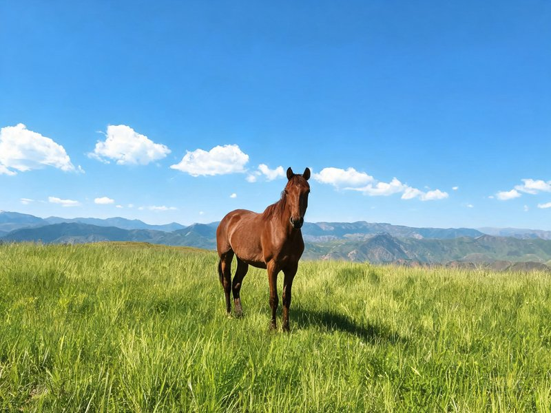
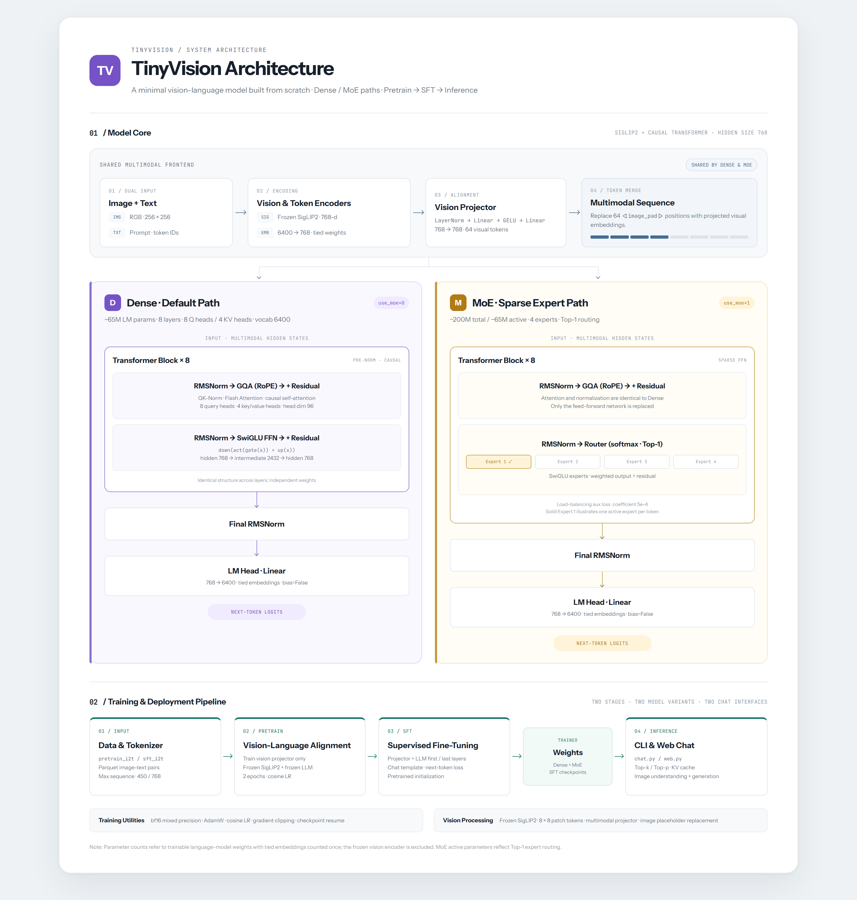
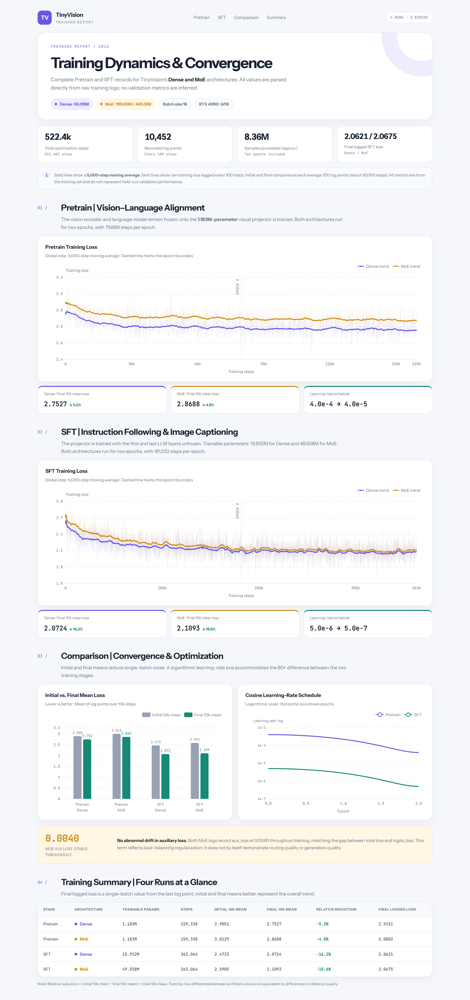

# TinyVision

[English](README.md) | [简体中文](README.zh-CN.md)

从零手写的极简视觉语言模型（VLM），完整覆盖 **数据 → 预训练 → 微调 → 转换 → 部署** 的全流程，适合学习和复现。

- **视觉编码器**：SigLIP 2（`siglip2-base-p32-256-ve`，patch 32×32，输入 256×256），全程冻结，输出 64 个视觉 token
- **语言模型**：纯 PyTorch 手写的 Llama 式架构（RMSNorm / RoPE / GQA / SwiGLU），默认从 flcmind SFT 权重初始化，也支持完全随机初始化
- **两种底座**：Dense（65.09M）与 MoE（199.60M，4 专家 Top-1，每 token 激活 65.12M）
- **分词器**：词表 6400 的自定义分词器，含 `<|image_pad|>` 等视觉特殊 token
- **投影层**：LayerNorm → Linear → GELU → Linear 的 MLP，把视觉特征映射到语言模型空间

| 资源 | 链接 |
|---|---|
| 模型权重 | [FLCgeigeigei/tinyvision-vlm](https://huggingface.co/FLCgeigeigei/tinyvision-vlm)（`dense/` 与 `moe/`） |
| 训练数据 | [FLCgeigeigei/tinyvision-vlm-data](https://huggingface.co/datasets/FLCgeigeigei/tinyvision-vlm-data) |

## 目录

- [模型效果](#模型效果)
- [模型架构](#模型架构)
- [安装](#安装)
- [获取权重与数据](#获取权重与数据)
- [快速开始](#快速开始)
- [训练](#训练)
- [模型转换与部署](#模型转换与部署)
- [数据集](#数据集)
- [项目结构](#项目结构)
- [已知限制](#已知限制)

## 模型效果

同一批图片下 Dense 与 MoE 的输出对比。示例用于展示原始模型行为；采样解码具有随机性，不同 checkpoint、提示词和解码参数可能得到不同结果，输出中的物体或属性描述可能有误。

| 输入 | Dense | MoE |
|---|---|---|
|  | 这张图片展示了一艘帆船在海上航行，船体是白色的。 | 这张图片展示了一艘帆船在水面上，看起来是在晴朗的蓝天下。船只主要是白色的，带有白色的帆，表明它是白色的。 |
|  | 这张图片展示了一匹马站在一片开阔的草地上，背景是晴朗的蓝天。 | 这张图片展示了一匹棕色的马，站在一片广阔的草地上，背景是晴朗的蓝天。这匹马有着浓密的胡须，头部略微向前倾斜，眼睛朝向画面右侧。 |
|  | 这张图片展示了一幅宁静的风景，在晴朗的蓝天下，一座山峰被积雪覆盖，暗示着寒冷的季节。 | 这张图片展示了一幅宁静的山脉景观，天空湛蓝，暗示着一个宁静的场景。前景是一片宁静的湖泊，湖面上倒映着天空的蓝色。 |
|  | 这张图片展示了一只鸟停在一根长长的叶子上，背景是郁郁葱葱的绿色植被。 | 这张图片展示了一只鸟停在一根细长的茎上，背景是郁郁葱葱的绿色。这只鸟主要是蓝色的，带有白色的鳞片，头部和腹部有白色的鳞片。 |

## 模型架构



图片经 SigLIP 2 编码为 64 个 patch token，由 MLP 投影层（LayerNorm → Linear → GELU → Linear）映射到语言模型维度，替换文本中的 `<|image_pad|>` 占位符后送入 decoder-only 语言模型。

视觉编码器（SigLIP 2 base，patch 32×32，输入 256×256）全程冻结，输出 768 维 × 64 token；投影层把 64 个视觉 token 映射到语言模型的 768 维空间。语言模型使用手写架构，默认加载 flcmind SFT 底座后继续训练；设置 `--from_weight none` 时可完全随机初始化，不加载现成 LLM 权重。

### 参数对照

| | Dense | MoE |
|---|---|---|
| 参数量（语言部分） | 65.09M | 199.60M（激活 65.12M） |
| FFN | SwiGLU | 4 专家 Top-1 路由 + 负载均衡辅助损失 |
| `hidden_size` / 层数 | 768 / 8 | 768 / 8 |
| 注意力 | GQA（8 查询头 / 4 KV 头，`head_dim=96`） | GQA（8 查询头 / 4 KV 头，`head_dim=96`） |
| 归一化 | RMSNorm（`eps=1e-6`） | RMSNorm（`eps=1e-6`） |
| 位置编码 | RoPE（`theta=1e6`，YaRN 可选） | RoPE（`theta=1e6`，YaRN 可选） |
| 词表 | 6400 | 6400 |
| 图像 token 数 | 64（256×256，patch 32×32） | 64（256×256，patch 32×32） |
| 推理精度 | bf16 直接可用 | MoE FFN 内部 fp32，必要时回退 fp32 |

训练曲线与收敛对比见 [训练报告图](figures/tinyvision-training-report.png)。

## 安装

需要 Python 3.9+ 与 PyTorch 2.0+。训练建议使用 CUDA 版 PyTorch，推理也支持 CPU；CUDA 对应的 PyTorch 安装命令见 [PyTorch 官方安装页](https://pytorch.org/get-started/locally/)。

```bash
# 在项目根目录执行
pip install -e .
pip install -U huggingface_hub  # 提供下文使用的 hf 命令

# 可选：Gradio Web 界面 / SwanLab 训练日志
pip install -e ".[web,log]"
```

其余依赖见 [pyproject.toml](pyproject.toml)。

## 获取权重与数据

仓库内的 `assets/` 不含模型权重与训练数据（体积较大），需要单独下载。只做推理时完成前两步即可，训练时再准备 LLM 底座与训练数据。

### 1. 语言模型权重（推理必需）

```bash
hf download FLCgeigeigei/tinyvision-vlm --local-dir tinyvision-vlm
```

下载后的 `tinyvision-vlm/dense/` 与 `tinyvision-vlm/moe/` 是 Transformers 格式模型，可直接用于下文的命令行推理。

### 2. 视觉编码器（训练和推理必需）

SigLIP 2 视觉编码器**不在**语言模型权重里（约 180 MB）。将上一步下载的编码器复制到程序默认读取目录：

```bash
mkdir -p assets/vision_encoder
cp -r tinyvision-vlm/vision_encoder/siglip2-base-p32-256-ve assets/vision_encoder/
```

也可以直接从变体仓库下载到默认目录（`model.safetensors` 与上面完全相同）：

```bash
hf download jingyaogong/siglip2-base-p32-256-ve --local-dir assets/vision_encoder/siglip2-base-p32-256-ve
```

Web 界面可用 `--vision_model` 指定其它路径，其它场景可用 `TINYVISION_VISION_MODEL` 环境变量覆盖默认路径。

### 3. 预训练 LLM 底座（训练必需）

语言模型默认从 [FLCgeigeigei/flcmind](https://huggingface.co/FLCgeigeigei/flcmind) 的 SFT 权重初始化，而不是从随机参数开始。下载 Dense 与 MoE 底座并放到 `assets/pretrained/`：

```bash
hf download FLCgeigeigei/flcmind --include "*.pth" --local-dir flcmind_hf

mkdir -p assets/pretrained
cp flcmind_hf/full_sft_768.pth     assets/pretrained/
cp flcmind_hf/moe_sft_768_moe.pth  assets/pretrained/
```

`resolve_weight_path()` 会在 `assets/pretrained/` 里按 `{prefix}_{hidden_size}[_moe].pth` 命名查找，因此前缀要对应：`full_sft` → `full_sft_768.pth`（Dense），`moe_sft` → `moe_sft_768_moe.pth`（MoE）。如果不需要任何现成 LLM 权重，训练时显式传入 `--from_weight none`。

### 4. 训练数据（训练必需）

训练入口默认读取单个 parquet 文件。以下命令分别下载两个配置的全部分片，并导出到默认路径：

```bash
mkdir -p assets/data

python -c "from datasets import load_dataset; load_dataset('FLCgeigeigei/tinyvision-vlm-data', 'pretrain_i2t', split='train').to_parquet('assets/data/pretrain_i2t.parquet')"
python -c "from datasets import load_dataset; load_dataset('FLCgeigeigei/tinyvision-vlm-data', 'sft_i2t', split='train').to_parquet('assets/data/sft_i2t.parquet')"
```

该过程会同时保留 Hugging Face 缓存和导出的 parquet 文件，请预留足够的磁盘空间。也可以通过 `--data_path` 指定其它单个 parquet 文件。

## 快速开始

### 1. 命令行图片问答

完成“获取权重与数据”的前两步后，直接加载下载好的 Transformers 模型：

```bash
# Dense
tinyvision-chat --load_from tinyvision-vlm/dense

# MoE
tinyvision-chat --load_from tinyvision-vlm/moe
```

程序默认遍历 `assets/demo_images/` 下所有图片逐张描述。若要加载自己训练得到的原生 `.pth`，使用默认的 `--load_from model`：

```bash
# Dense 原生 pth
tinyvision-chat

# MoE 原生 pth
tinyvision-chat --use_moe 1
```

原生权重自动在 `assets/pretrained/` 与 `assets/outputs/*/final/` 中查找（`resolve_weight_path` 顺序：显式 `--save_dir` → `pretrained/` → `outputs/{weight}/final/`）；该查找逻辑不适用于 `--load_from` 指定的 Transformers 目录。

| 参数 | 说明 | 默认 |
|---|---|---|
| `--use_moe` | 原生 pth 是否使用 MoE 架构；Transformers 模型从 config 读取 | 0 |
| `--load_from` | 模型来源，`model` 为原生 pth，其他路径按 Transformers 格式加载 | `model` |
| `--save_dir` | 权重所在目录 | 自动查找 |
| `--weight` | 权重名前缀 | `sft_vlm` |
| `--image_dir` | 测试图片目录 | `assets/demo_images` |
| `--max_new_tokens` | 最大生成长度 | 512 |
| `--temperature` / `--top_p` | 采样温度 / nucleus 阈值 | 0.7 / 0.85 |
| `--device` | 运行设备 | 有 CUDA 时 `cuda`，否则 `cpu` |
| `--show_speed` | 打印 decode 速度（tokens/s） | 1 |

### 2. Web 界面

```bash
tinyvision-web
```

扫描 `assets/outputs/transformers/` 下的 Transformers 格式模型，浏览器访问 Gradio 地址后上传图片交互问答（需先执行转换）。模型下拉框可在多个转换产物之间切换。

### 3. 从 Hugging Face 加载

```python
from transformers import AutoModelForCausalLM, AutoTokenizer

model = AutoModelForCausalLM.from_pretrained(
    "FLCgeigeigei/tinyvision-vlm", subfolder="dense", trust_remote_code=True, dtype="bfloat16"
)
tokenizer = AutoTokenizer.from_pretrained("FLCgeigeigei/tinyvision-vlm", subfolder="dense")

# 视觉编码器不在 LLM 权重里，需要单独挂载
model.vision_encoder, model.processor = model.get_vision_model(
    "tinyvision-vlm/vision_encoder/siglip2-base-p32-256-ve"
)
```

要点：
- 必须 `trust_remote_code=True`，自定义架构通过 `auto_map` 从 `vlm.py` 加载
- 每张图片对应 **64 个 `<|image_pad|>`**，与 256×256 输入下 SigLIP 2 输出的 patch 数一致
- 视觉编码器**不在** LLM 权重里（`model.safetensors` 只存语言模型 + 投影层），必须单独挂载
- `dense` 可直接用 `bfloat16`；`moe` 的 MoE FFN 内部已提升到 fp32 计算，若仍遇 NaN 请退回 `dtype="float32"`
- 模型自带 `chat_template.jinja`，用 `tokenizer.apply_chat_template(messages, tokenize=False, add_generation_prompt=True)` 构造输入
- 完整示例见 [Hugging Face 模型卡片](https://huggingface.co/FLCgeigeigei/tinyvision-vlm)

## 训练

两阶段共用一个入口，用 `--stage` 切换：

建议显式指定 `--from_weight`，避免 Dense 与 MoE 的初始化权重混淆：

```bash
# Dense：1. 图文预训练，冻结 LLM 与视觉编码器，仅训练投影层
tinyvision-train --stage pretrain --from_weight full_sft

# Dense：2. 监督微调，接着 Pretrain 产物训练并解冻首尾 LLM 层
tinyvision-train --stage sft

# MoE：1. 图文预训练
tinyvision-train --stage pretrain --use_moe 1 --from_weight moe_sft

# MoE：2. 监督微调
tinyvision-train --stage sft --use_moe 1
```

数据默认读取 `assets/data/pretrain_i2t.parquet` 与 `assets/data/sft_i2t.parquet`；`--data_path` 当前按单个 parquet 文件读取，使用数据集分片时请按“获取权重与数据”中的命令先导出合并。产物保存到 `assets/outputs/{model_name}/final/`（`.pth`，不含视觉编码器权重），断点存于 `assets/outputs/{model_name}/checkpoints/`。

上方命令的 Dense 两阶段衔接关系：

```text
[Dense LLM 底座]
assets/pretrained/full_sft_768.pth
        │
        │ Pretrain：仅训练投影层
        ▼
[Pretrain 产物]
assets/outputs/pretrain_vlm/final/pretrain_vlm_768.pth
        │
        │ SFT：解冻首尾 LLM 层
        ▼
[SFT 产物]
assets/outputs/sft_vlm/final/sft_vlm_768.pth
```

即：**Pretrain 从 flcmind 的 LLM 底座出发**（只训投影层），**SFT 再接着 Pretrain 的产物继续训**（解冻首尾层）。`--from_weight` 可以改成任意其它前缀或 `none`（完全从随机初始化开始）。

下表列出 CLI 的原始默认值。注意 Pretrain 的 `--from_weight` 默认是 `moe_sft`，因此 Dense 训练建议按上方命令显式传入 `full_sft`。

| 参数 | 说明 | 默认 |
|---|---|---|
| `--stage` | 训练阶段，`pretrain` / `sft` | `sft` |
| `--epochs` | 训练轮数 | 2 |
| `--batch_size` | 批大小 | 16 |
| `--learning_rate` | 初始学习率 | pretrain 4e-4 / sft 5e-6（cosine 衰减） |
| `--max_seq_len` | 序列截断长度 | pretrain 450 / sft 768 |
| `--freeze_llm` | 0 全可训 / 1 解冻首尾层 / 2 全冻结仅训投影层 | pretrain 2 / sft 1 |
| `--from_weight` | 基于哪个权重继续训练，`none` 表示不加载 | pretrain `moe_sft` / sft `pretrain_vlm` |
| `--from_resume` | 自动检测并断点续训 | 0 |
| `--use_moe` | 是否使用 MoE 架构 | 0 |
| `--accumulation_steps` | 梯度累积步数 | 1 |
| `--grad_clip` | 梯度裁剪阈值 | 1.0 |
| `--dtype` | 混合精度类型 | `bfloat16` |
| `--num_workers` | 数据加载线程数 | 8 |
| `--device` | 训练设备 | `cuda:0`（无 CUDA 时 `cpu`） |
| `--use_compile` | 启用 `torch.compile` | 0 |
| `--use_wandb` | 启用 SwanLab 日志 | 关闭 |

支持 DDP 多卡（`torchrun` + `RANK`/`LOCAL_RANK` 环境变量）、bf16/fp16 混合精度、梯度累积、梯度裁剪与断点续训；`--from_resume 1` 时会按当前 GPU 数量自动折算步数。

### 实际训练配置

RTX 4090 · bf16 · batch size 16，两阶段各 2 个 epoch，共 522,402 个优化步。

| 阶段 | 架构 | 样本数 | 总步数 | 单轮耗时 | 可训参数 | 初始 10k 均值 | 最终 10k 均值 | 降幅 |
|---|---|---|---|---|---|---|---|---|
| Pretrain | Dense | 1,274,698 | 159,338 | ≈1.9 h | 1.183M | 2.9051 | 2.7527 | −5.2% |
| Pretrain | MoE | 1,274,698 | 159,338 | ≈3.0 h | 1.183M | 3.0129 | 2.8688 | −4.8% |
| SFT | Dense | 2,904,511 | 363,064 | ≈6.6 h | 15.932M | 2.4733 | 2.0724 | −16.2% |
| SFT | MoE | 2,904,511 | 363,064 | ≈15.6 h | 49.558M | 2.5905 | 2.1093 | −18.6% |

> 耗时为单个 epoch 的实测时长（由训练日志推算）。表中 loss 为训练集指标，非留出集验证性能；不同架构的训练 loss 差异不等价于推理质量差异。

### 训练报告



## 模型转换与部署

把原生 `.pth` 权重转为 Transformers 格式（`config.json` + `pytorch_model.bin` + `vlm.py`）。当前转换脚本使用 `safe_serialization=False`，因此本地转换产物是 `pytorch_model.bin`，不是 `model.safetensors`：

```bash
# Dense（--use_moe 默认值为 1，务必显式传 0）
tinyvision-convert --use_moe 0

# MoE
tinyvision-convert --use_moe 1
```

转换产物位于 `assets/outputs/transformers/`，可直接被 `tinyvision-web` 扫描，也可用 `transformers` 以 `trust_remote_code=True` 加载。转换时会剔除视觉编码器权重并统一转成 bf16。

| 参数 | 说明 | 默认 |
|---|---|---|
| `--use_moe` | 是否使用 MoE 架构 | **1**（务必显式传 `0` 才是 Dense） |
| `--torch_path` | 原生 pth 权重路径 | `assets/outputs/sft_vlm/final/sft_vlm_768[_moe].pth` |
| `--transformers_path` | 输出目录 | `assets/outputs/transformers/tinyvision-3v[_moe]` |
| `--hidden_size` / `--num_hidden_layers` | 与训练时保持一致 | 768 / 8 |
| `--max_seq_len` | 最大序列长度 | 8192 |

反向转换（Transformers → 原生 pth）见 `convert_transformers2torch()`。

## 数据集

[FLCgeigeigei/tinyvision-vlm-data](https://huggingface.co/datasets/FLCgeigeigei/tinyvision-vlm-data)，256×256 图文对，原始 JPEG 字节内嵌在 `image_bytes` 列。

| 配置 | 分片 | 条数 | 体积 | 用途 |
|---|---|---|---|---|
| `pretrain_i2t` | 41 | 1,274,698 | 4.53 GB | 图文预训练 |
| `sft_i2t` | 47 | 2,904,511 | 5.30 GB | 监督微调（视觉问答） |

| 列 | 类型 | 说明 |
|---|---|---|
| `conversations` | string | JSON 编码的消息列表，单轮 `user` → `assistant` |
| `image_bytes` | binary | 原始 JPEG 字节，图片均已缩放到 256×256 |

`<image>` 占位符的位置在样本中不固定（可能在问题前，也可能在后），加载器按文本内标记处理并替换为 64 个 `<|image_pad|>`。约 46% 的样本含中文，其余为英文。许可为 [CC BY 4.0](https://creativecommons.org/licenses/by/4.0/)。

## 项目结构

```text
tinyvision/
├── assets/
│   ├── vision_encoder/siglip2-base-p32-256-ve/   # 冻结的 SigLIP 2 视觉编码器（需下载）
│   ├── tokenizer/                                # 分词器
│   ├── data/                                     # 训练数据（parquet，需下载）
│   ├── demo_images/                              # 测试图片
│   ├── pretrained/                               # 预训练 LLM 底座
│   └── outputs/                                  # 训练产物（final / checkpoints / transformers）
├── src/tinyvision/
│   ├── models/          # llm.py（LLM 底座）、vlm.py（TinyVisionVLM）
│   ├── data/            # vlm_dataset.py（parquet 读取、chat template、label mask）
│   ├── training/        # train.py（训练入口）、utils.py（初始化/断点/工具）
│   ├── inference/       # engine.py（原生 pth 与 Transformers 两种加载路径）
│   ├── cli/             # chat.py（命令行）、web.py（Gradio）、convert.py（格式转换）
│   └── paths.py         # 路径常量（可用 TINYVISION_ROOT 覆盖根目录）
├── figures/             # 架构图、训练报告图
├── pyproject.toml
└── requirements.txt
```

## 已知限制

- 模型极小（65M 激活参数），世界知识有限，描述容易出错；输出为原始模型行为，未做安全对齐
- 仅支持中英文，词表 6400
- 未做 RLHF / 安全微调
- 长文本能力有限：SFT 阶段序列长度上限 768 token
- 定位是学习与实验，不适合生产部署

## 许可

Apache-2.0。视觉编码器 SigLIP 2 遵循其自身许可，训练数据遵循 [CC BY 4.0](https://creativecommons.org/licenses/by/4.0/)。
